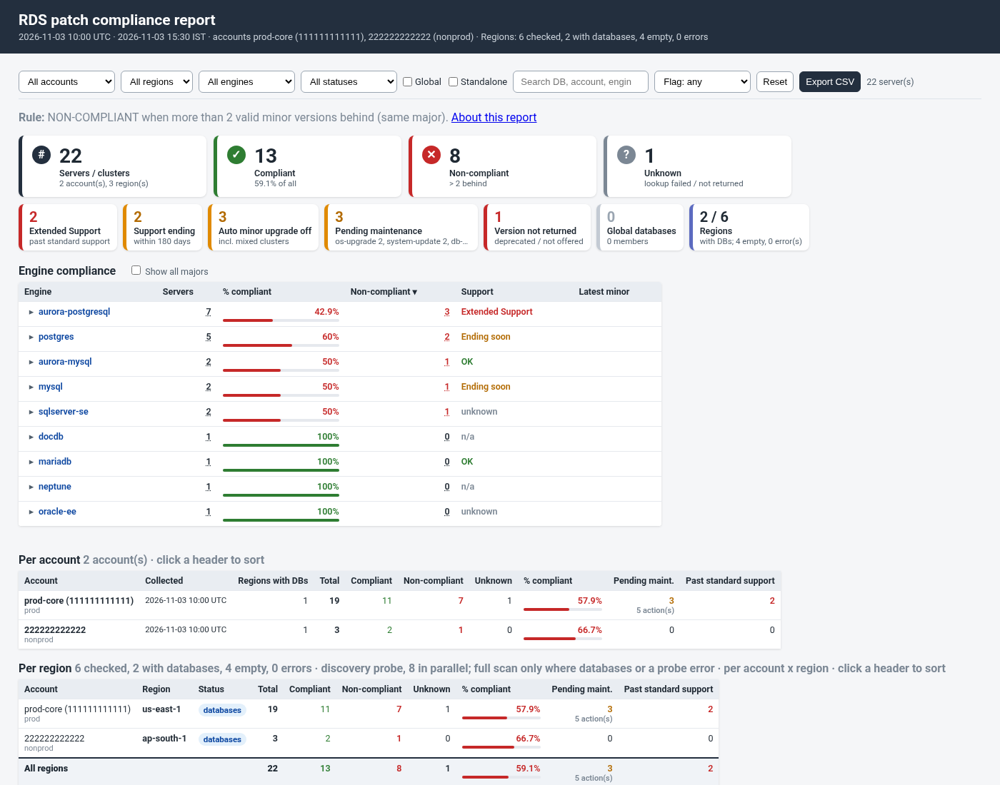
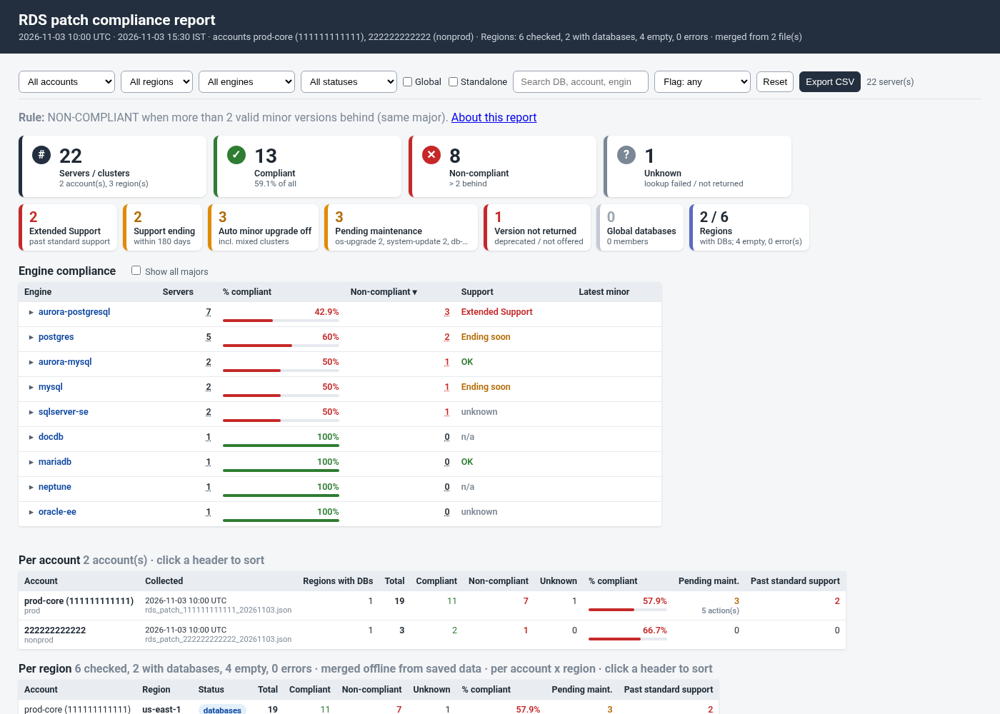
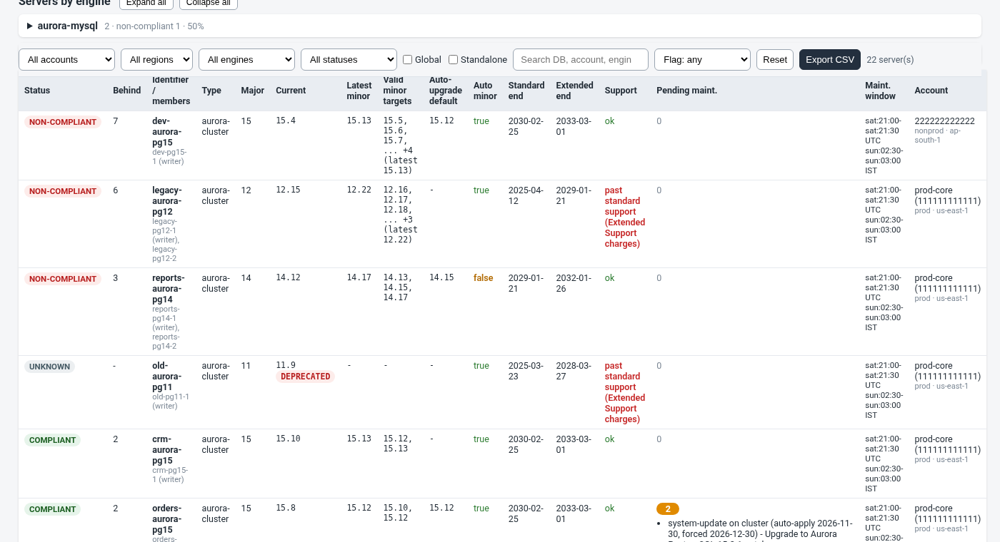
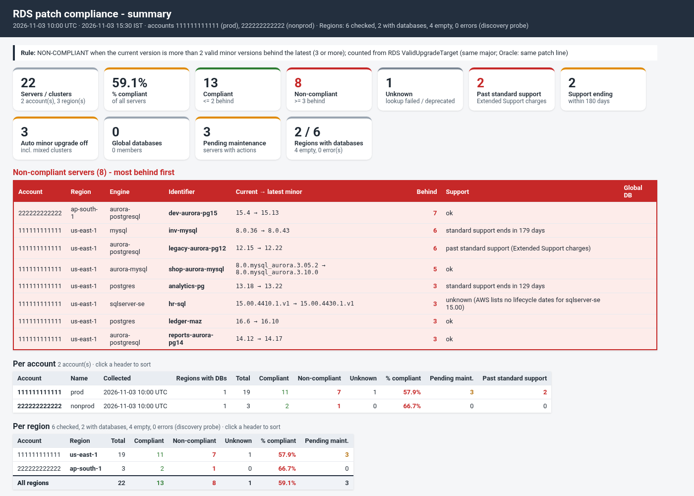

# rds-patch-compliance-powershell

`Invoke-RdsPatchCompliance.ps1` is a **read-only** patch compliance report for AWS databases, written in
PowerShell 7. It is a port of the Bash tool
[`rds_patch_compliance_report.sh`](https://github.com/manideepgrandhi/rds-patch-compliance) v1.5.1
and gives the same results.

For every Aurora cluster, RDS instance, Multi-AZ DB cluster, DocumentDB cluster and Neptune cluster, the
report shows how many **minor versions** the database is behind. It then marks the database
**COMPLIANT**, **NON-COMPLIANT** or **UNKNOWN**. It also flags these conditions:

- majors past, or close to, the end of standard support (Extended Support charges)
- auto minor upgrade switched off
- pending maintenance
- deprecated versions

The report covers several accounts and regions. It writes text, CSV, JSON and a single-file offline
HTML page.

```powershell
./Invoke-RdsPatchCompliance.ps1 -ProfileName prod,nonprod -Region us-east-1,ap-south-1 -Format csv,html,text -OutputDir ~/compliance
```



Release history: [CHANGELOG.md](CHANGELOG.md). More examples: [EXAMPLES.md](EXAMPLES.md).
How it differs from the Bash code: [COMPARISON.md](COMPARISON.md). Option-by-option mapping:
[FEATURE-PARITY.md](FEATURE-PARITY.md). Latest test run: [docs/TEST-RESULTS.md](docs/TEST-RESULTS.md).

> **Status:** v1.0.0, on the `feature/powershell-port` branch (draft PR). It is not released yet.

## Contents

- [Features](#features)
- [Requirements](#requirements)
- [Install](#install)
- [Quick start](#quick-start): [Windows](#windows), [Linux jump box](#linux-jump-box-one-role-profile-per-account), [AWS CloudShell](#aws-cloudshell)
- [Several accounts: -SaveData, then -Merge](#several-accounts--savedata-then--merge)
- [The compliance rule](#the-compliance-rule)
- [Parameters](#parameters)
- [Output files](#output-files)
- [Exit codes](#exit-codes)
- [Summary script](#summary-script)
- [Alerts](#alerts)
- [Configuration file](#configuration-file)
- [IAM permissions (read-only)](#iam-permissions-read-only)
- [How it maps to the Bash version](#how-it-maps-to-the-bash-version)
- [Tests](#tests)
- [Repository layout](#repository-layout)

## Features

- **Same rule and same output as the Bash tool.** For the same data, the CSV, regions CSV, text and JSON
  rows are byte-for-byte the same. The HTML differs only in the footer, which names the tool and its
  version. The tests check this on every run.
- **Engines.**
  - Aurora PostgreSQL and Aurora MySQL clusters, judged per cluster. Members are listed.
  - Multi-AZ DB clusters, judged per cluster.
  - DocumentDB and Neptune clusters, judged per cluster.
  - Standalone RDS instances (`postgres`, `mysql`, `mariadb`, `sqlserver-*`, `oracle-*`), judged per
    instance. Read replicas get their own row.
- **Versions behind come from RDS itself.** The count is the number of valid minor upgrade targets
  (`ValidUpgradeTarget`, `IsMajorVersionUpgrade = false`) for the current version, looked up in the
  server's region. Oracle counts only targets on the same patch line, unless you set
  `-OracleAnyPatchLine`.
- **Lifecycle.** The report shows standard and extended support end dates. `-WarnDays` sets how early
  "support ends soon" is flagged.
- **Pending maintenance**, including member actions on clusters, with auto-apply and forced dates in UTC
  and IST.
- **Aurora global databases.** One lookup per account. The worst member decides the overall status, and
  region mismatches are flagged.
- **Account names**, taken from the config file, then the IAM account alias, then the account number.
- **All regions.** `-AllRegions` with a parallel discovery probe (`-ProbeParallel`). Only regions that
  have databases are scanned in full. A failed probe is reported, and that region is still scanned.
- **Several accounts in one run** (`-ProfileName a,b,c`). If one profile fails, it is reported and the
  others still run.
- **Offline merge.** Run `-SaveData` in each account, then `-Merge` the files anywhere. The merge makes no
  AWS calls. **Files saved by the Bash tool merge here, and files saved here merge in the Bash tool.**
- **Manager summary.** `Invoke-RdsPatchComplianceSummary.ps1` shows totals and the NON-COMPLIANT servers
  only, with the same numbers as the full report.
- **Alerts** by e-mail (`mail`/`mailx`/`sendmail`, or an SMTP relay on Windows) and webhooks (Slack or
  JSON).
- **Scheduling and CI.** `-FailOnNonCompliant` exits with code 5 when anything is NON-COMPLIANT.
  `-LogFile`, `-DryRun` and `-ConfigFile` are also available.
- **Two AWS back ends.** `-AwsBackend AwsTools`, the default, uses the AWS.Tools modules in one
  process. `-AwsBackend Cli` uses the AWS CLI v2 and runs the same commands as the Bash tool.
- **Strictly read-only.** Only describe, list and get calls are made. The tool never creates an upgrade
  or modify command, and never runs one.

## Requirements

| | |
|---|---|
| PowerShell | **7.2 or later** (`pwsh`) on Windows, Linux or macOS. Windows PowerShell 5.1 is not supported. |
| AWS, option 1 (default `-AwsBackend AwsTools`) | `AWS.Tools.Common`, `AWS.Tools.SecurityToken`, `AWS.Tools.EC2` and `AWS.Tools.RDS`. Optional: `AWS.Tools.IdentityManagement` for account aliases, and `AWS.Tools.DocDB` / `AWS.Tools.Neptune` for DocumentDB and Neptune engine versions. |
| AWS, option 2 (`-AwsBackend Cli`) | AWS CLI v2. Version 2.15 or later is recommended, for `describe-db-major-engine-versions`. |
| Merge only | Nothing beyond `pwsh`. `-Merge` makes no AWS calls and loads no AWS module. |
| Not needed | jq, bash, curl, coreutils |

## Install

```powershell
# 1. Get the code (or download the ZIP from GitHub and extract it)
git clone https://github.com/manideepgrandhi/rds-patch-compliance-powershell.git
cd rds-patch-compliance-powershell

# 2. AWS.Tools (once per user; skip this if you use -AwsBackend Cli)
Install-Module AWS.Tools.Installer -Scope CurrentUser
Install-AWSToolsModule AWS.Tools.Common, AWS.Tools.SecurityToken, AWS.Tools.EC2, AWS.Tools.RDS, `
    AWS.Tools.IdentityManagement, AWS.Tools.DocDB, AWS.Tools.Neptune -Scope CurrentUser

# 3. Check it
./Invoke-RdsPatchCompliance.ps1 -Version          # Invoke-RdsPatchCompliance.ps1 1.0.0
./Invoke-RdsPatchCompliance.ps1 -Help             # every parameter
```

Windows only: if you downloaded the code as a ZIP, unblock the files once, because Windows marks them as
"from the internet":

```powershell
Get-ChildItem -Recurse -Include *.ps1, *.psm1 | Unblock-File
```

To use the tool as a module, import it with `Import-Module ./src/RdsPatchCompliance.psm1` and call
`Invoke-RdsPatchCompliance`. The function returns the exit code and does not close your session. Keep
`src/` and `assets/` together.

## Quick start

All account numbers in this README are fake: 111111111111 is prod, 222222222222 is nonprod and
333333333333 is dev.

### Windows

```powershell
# PowerShell 7 (pwsh), profile "prod" from %USERPROFILE%\.aws\config
cd C:\tools\rds-patch-compliance-powershell
.\Invoke-RdsPatchCompliance.ps1 -ProfileName prod -Region us-east-1 -Format html,csv -OutputDir C:\reports
#   -> C:\reports\rds_patch_compliance_111111111111_20261103_153000.html / .csv / _regions.csv

# from Windows PowerShell 5.1 or cmd.exe, start pwsh explicitly
pwsh -NoProfile -File C:\tools\rds-patch-compliance-powershell\Invoke-RdsPatchCompliance.ps1 -ProfileName prod -AllRegions -Format html -OutputDir C:\reports
```

Windows has no `mail` command. For e-mail alerts, add `-AlertSmtpServer smtp.example.com`. For a weekly
run, use Task Scheduler. See [EXAMPLES.md](EXAMPLES.md#scheduling).

### Linux jump box: one role profile per account

The jump box has an EC2 instance role that may assume a read-only role in each account. Define one
profile per account in `~/.aws/config`. Each profile gets its credentials from the instance metadata, so
no keys are stored on the box.

```ini
[profile prod]
role_arn          = arn:aws:iam::111111111111:role/dbops_compliance_role
credential_source = Ec2InstanceMetadata
region            = us-east-1

[profile nonprod]
role_arn          = arn:aws:iam::222222222222:role/dbops_compliance_role
credential_source = Ec2InstanceMetadata
region            = ap-south-1

[profile dev]
role_arn          = arn:aws:iam::333333333333:role/dbops_compliance_role
credential_source = Ec2InstanceMetadata
region            = eu-west-1
```

Then scan every account in one run:

```bash
pwsh ./Invoke-RdsPatchCompliance.ps1 -ProfileName prod,nonprod,dev -AllRegions -Format html,csv -OutputDir ~/compliance
```

AWS.Tools and the AWS CLI read the same `~/.aws/config`. Both support `role_arn` with
`credential_source` or `source_profile`, and SSO profiles. If a profile fails (for example, the role
does not trust the jump box), the run reports it, scans the other accounts and still exits 0.

### AWS CloudShell

CloudShell already has `pwsh`, the AWS CLI and AWS Tools for PowerShell, and it signs you in to the
account. Nothing else is needed.

```bash
git clone https://github.com/manideepgrandhi/rds-patch-compliance-powershell.git ~/rds-patch-compliance-powershell
cd ~/rds-patch-compliance-powershell
pwsh ./Invoke-RdsPatchCompliance.ps1 -AllRegions -Format html -OutputDir ~/compliance -SaveData
#   -> ~/compliance/rds_patch_compliance_111111111111_20261103_153000.html
#   -> ~/compliance/rds_patch_111111111111_20261103.json   (Actions > Download file, for -Merge)
```

If AWS.Tools is missing in your CloudShell, add `-AwsBackend Cli`.

## Several accounts: -SaveData, then -Merge

Use this when there is no single place that can reach every account. Run the report in each account,
for example in its CloudShell, and save the raw data. Then merge the files anywhere. The merge makes
**no AWS calls** and needs no AWS module.

```powershell
# 1) in each account (CloudShell or the jump box)
./Invoke-RdsPatchCompliance.ps1 -AllRegions -Format html -OutputDir ~/compliance -SaveData
#   -> rds_patch_111111111111_20261103.json  (one file per account per day)

# 2) on a laptop: put the downloaded files in one folder, then
./Invoke-RdsPatchCompliance.ps1 -Merge 'C:\Users\me\Downloads\patch data' -OutputDir C:\reports\all-accounts.html
./Invoke-RdsPatchCompliance.ps1 -Merge ./data -Format text,csv,html -OutputDir ./combined
./Invoke-RdsPatchComplianceSummary.ps1 -Merge ./data -Format txt,html,csv -OutputDir ./combined
```

- `-Merge` accepts files, folders and wildcards. To pass several, separate them with spaces, for example
  `-Merge ./a ./b/*.json`.
- **Bash and PowerShell data files can be mixed.** This tool reads `--save-data` files from the Bash
  tool (v1.3.0 and later), and the Bash `--merge` reads files saved by this tool. The tests check all
  four directions. A worked example is in [EXAMPLES.md](EXAMPLES.md#merge-files-saved-by-the-bash-tool).
- If the same account appears in two files, the newer collection wins. Days to end of support are
  counted from the time of the merge.
- `-MaxBehind`, `-WarnDays`, `-OracleAnyPatchLine`, `-FailOnNonCompliant` and the alert parameters also
  work with `-Merge`.
- Sample output: [samples/sample_merged.txt](samples/sample_merged.txt),
  [samples/sample_merged.html](samples/sample_merged.html). The two input files are in
  [samples/data/](samples/data/). The prod file was saved by this tool and the nonprod file by the Bash
  tool.



## The compliance rule

```
versions_behind = number of valid MINOR upgrade targets RDS returns for the current version
                  (describe-db-engine-versions --engine E --engine-version <current>,
                   ValidUpgradeTarget with IsMajorVersionUpgrade = false; Oracle: same patch line)

COMPLIANT      versions_behind <= -MaxBehind (default 2)
NON-COMPLIANT  versions_behind  > -MaxBehind (3 or more by default)
UNKNOWN        the lookup failed, or RDS does not return the current version (deprecated)
```

The other flags (support dates, auto minor upgrade, pending maintenance) are shown, but they do not
change the status. The rule is the same as the Bash tool's, so its README explains it in more depth.
See the
[compliance rule](https://github.com/manideepgrandhi/rds-patch-compliance#the-compliance-rule) and
[Oracle patch lines](https://github.com/manideepgrandhi/rds-patch-compliance#oracle-versions-patch-lines).

## Parameters

`./Invoke-RdsPatchCompliance.ps1 -Help` prints this list. `Get-Help ./Invoke-RdsPatchCompliance.ps1 -Full`
also works. Lists can be comma-separated (`-Region us-east-1,ap-south-1`) or PowerShell arrays.

| Parameter | Bash option | Meaning |
|---|---|---|
| `-ProfileName` (`-Profile`, `-P`) | `-P, --profile` | AWS profile(s) / accounts. Default: the normal credential chain. |
| `-Region` (`-r`) | `-r, --region` | Region(s). Default: the profile's or environment's region. |
| `-AllRegions` (`-A`) | `-A, --all-regions` | Every enabled region. Each region is probed first and scanned in full only if it has databases. |
| `-NoDiscover` / `-Discover` | `--no-discover` / `--discover` | With `-AllRegions`: skip the probe and scan every region in full / probe first (default). |
| `-ProbeParallel N` | `--probe-parallel N` | Regions probed at the same time (default 8, 1–32). |
| `-Engine GLOB` (`-e`) | `-e, --engine` | Engine filter, for example `aurora-postgresql`, `'sqlserver-*'` or `'oracle-*'`. Case-insensitive globs. |
| `-Identifier GLOB` (`-i`) | `-i, --identifier` | Cluster or instance identifier filter. A cluster also matches by a member's name. |
| `-MaxBehind N` | `--max-behind N` | COMPLIANT when at most N minor versions behind (default 2). |
| `-WarnDays N` | `--warn-days N` | Flag majors whose standard support ends within N days (default 180). |
| `-NonCompliantOnly` | `--non-compliant-only` | List only NON-COMPLIANT rows. The totals still count everything. |
| `-OracleAnyPatchLine` | `--oracle-any-patch-line` | Oracle: also count targets on other patch lines. |
| `-FailOnNonCompliant` | `--fail-on-noncompliant` | Exit 5 when anything is NON-COMPLIANT. |
| `-Format` (`-F`) | `-F, --format` | `text`, `csv`, `json`, `html` (`txt` = `text`). Default: text on the screen. More than one format needs `-OutputDir`. |
| `-OutputDir` (`-o`) | `-o, --output-dir` | Output folder. `DIR/NAME.html` names the HTML file. |
| `-Prefix` | `--prefix` | File name prefix (default `rds_patch_compliance`). |
| `-SaveData` / `-SaveDataFile FILE.json` | `--save-data [FILE]` | Also save the raw data for `-Merge`: one file per account, or all accounts in one named file. |
| `-Merge FILE\|DIR\|GLOB ...` | `--merge` | Build one report from saved data files, offline. The default format is html. |
| `-Tz ZONE` | `--tz` | Second time zone in the header (default `Asia/Kolkata`). IANA ids everywhere; on Windows, Windows ids such as `India Standard Time` work too. |
| `-LogFile` (`-l`) | `-l, --log-file` | Append the log lines to a file. |
| `-AlertEmail`, `-AlertFrom` | `--alert-email`, `--alert-from` | E-mail alert. See [Alerts](#alerts). |
| `-AlertSmtpServer`, `-AlertSmtpPort` | *(new)* | Send e-mail through an SMTP relay instead of `mail` (Windows). |
| `-AlertWebhook`, `-AlertWebhookFormat slack\|json` | `--alert-webhook`, `--alert-webhook-format` | Webhook alert. |
| `-AlertOn noncompliant\|always` | `--alert-on` | When to alert (default `noncompliant`, which includes AWS errors). |
| `-AlertTest` | `--alert-test` | Send a test alert and exit. |
| `-ConfigFile` (`-Config`) | `--config` | Read settings from a `key = value` file. Command-line parameters win. |
| `-AwsBackend AwsTools\|Cli` | *(new)* | AWS.Tools modules (default) or the AWS CLI v2. |
| `-AwsTimeout SEC`, `-MaxAttempts N` | `--aws-timeout`, `--max-attempts` | AWS timeout (default 30) and retries (default 5). |
| `-KeepWorkdir` | `--keep-workdir` | Keep the raw AWS responses, one JSON file per call. |
| `-DryRun` | `--dry-run` | Print the AWS calls that would run, without calling anything. |
| `-Verbose` / `-Debug` | `-v` | Debug logging. |
| `-TagColumns`, `-Top` | `-T`, `--top` | Accepted and ignored, as in Bash v1.4.0 and later. |
| `-Help` (`-h`), `-Version` (`-V`) | `-h`, `-V` | Help and version. |

## Output files

The `YYYYmmdd_HHMMSS` stamp is in the machine's local time. Single-account runs add the account
number to the name.

| File | When |
|---|---|
| `<prefix>_<ACCOUNT>_YYYYmmdd_HHMMSS.{txt,csv,json,html}` | one account (`-OutputDir DIR`) |
| `<prefix>_YYYYmmdd_HHMMSS.{txt,csv,json,html}` | several accounts, or a merge |
| `<prefix>[_<ACCOUNT>]_YYYYmmdd_HHMMSS_regions.csv` | always written next to the CSV: one row per account and region with databases or an error, plus `ALL` |
| `rds_patch_<ACCOUNT>_<YYYYMMDD>.json` | `-SaveData`, one file per account (the same name and format as the Bash tool) |
| `DIR/NAME.html` | `-OutputDir DIR/NAME.html` with `-Format html` (the default for `-Merge`) |

Samples generated from the test mock (2 accounts, all regions):
[text](samples/sample_report.txt) · [CSV](samples/sample_report.csv) ·
[regions CSV](samples/sample_report_regions.csv) · [JSON](samples/sample_report.json) ·
[HTML](samples/sample_report.html). To regenerate them, run `pwsh ./tools/Build-Samples.ps1`.

The CSV has 28 columns, the same as the Bash tool: `account_id`, `profile`, `region`, `resource_type`,
`identifier`, `members`, `engine`, `major_version`, `current_version`, `latest_minor_version`,
`versions_behind`, `newer_versions`, `default_auto_upgrade_target`, `compliance_status`,
`auto_minor_upgrade`, `standard_support_end`, `extended_support_end`, `support_flag`,
`pending_actions_count`, `pending_actions`, `deprecated_version`, `maint_window_utc`, `maint_window_ist`,
`next_maintenance`, `days_until_maintenance`, `global_cluster`, `global_role` and `account_name`.



## Exit codes

| Code | Meaning |
|---|---|
| 0 | Report produced or merged, even when servers are non-compliant |
| 1 | Usage error (bad parameter or value, unknown config key, output folder not writable at start) |
| 2 | Pre-check failed: no AWS back end, or no profile has valid credentials |
| 3 | Bad `-Merge` input (missing file, not a data file, broken JSON) |
| 4 | Output error (a report file could not be written or rendered) |
| 5 | NON-COMPLIANT found. Only with `-FailOnNonCompliant`. |

Partial AWS errors, such as a region that denies access or a failed probe, are listed under ERRORS in the
report. They do not change the exit code. Ctrl+C stops the run. Because files are written atomically, no
half-written files are left behind.

## Summary script

`Invoke-RdsPatchComplianceSummary.ps1` is for managers and teams. It shows only the high-level picture
and the **NON-COMPLIANT servers**. It runs the full report in the same process, so the numbers are the
same as the full report's.

```powershell
./Invoke-RdsPatchComplianceSummary.ps1 -ProfileName prod,nonprod -AllRegions                      # txt on the screen
./Invoke-RdsPatchComplianceSummary.ps1 -ProfileName prod -AllRegions -Format txt,html,csv -OutputDir ~/compliance
./Invoke-RdsPatchComplianceSummary.ps1 -Merge ./data -Format txt,html,csv -OutputDir ./combined    # offline
```

- **Formats:** `txt` (on the screen by default), `html` (one page), and `csv`. The `csv` format writes
  four files: `_summary.csv`, `_noncompliant.csv`, `_accounts.csv` and `_regions.csv`.
- **File names:** `rds_patch_compliance_summary[_<ACCOUNT>]_YYYYmmdd_HHMMSS`. The stamp is in UTC, as in
  the Bash tool.
- **Parameters:** `-ProfileName`, `-Region`, `-AllRegions`, `-NoDiscover`, `-ProbeParallel`, `-Engine`,
  `-Identifier`, `-MaxBehind`, `-WarnDays`, `-OracleAnyPatchLine`, `-Format`, `-OutputDir`, `-Prefix`,
  `-SaveData`, `-SaveDataFile`, `-Merge`, `-FailOnNonCompliant`, `-Alert*`, `-AwsBackend`, `-Verbose`.
- **Samples:** [summary txt](samples/sample_summary.txt), [summary html](samples/sample_summary.html),
  [merged summary txt](samples/sample_summary_merged.txt),
  [merged accounts CSV](samples/sample_summary_merged_accounts.csv).



## Alerts

Alerts are sent after the report is written. With the default `-AlertOn noncompliant`, they go out
only when something is NON-COMPLIANT or there were AWS errors. Use `-AlertOn always` to send one after
every run.

```powershell
# Linux / macOS / CloudShell: uses mail, mailx or sendmail, the same as Bash
./Invoke-RdsPatchCompliance.ps1 -ProfileName prod -AllRegions -AlertEmail dba-team@example.com

# Windows: through an SMTP relay (unauthenticated, no TLS; for example an internal Exchange or Postfix relay)
.\Invoke-RdsPatchCompliance.ps1 -ProfileName prod -AllRegions -AlertEmail dba-team@example.com `
    -AlertFrom rds-compliance@example.com -AlertSmtpServer smtp.example.com -AlertSmtpPort 25

# Slack (or Teams/any JSON endpoint with -AlertWebhookFormat json); the URL is never logged in full
./Invoke-RdsPatchCompliance.ps1 -ProfileName prod -AllRegions -AlertWebhook https://hooks.slack.com/services/XXX/YYY/ZZZ

# check the wiring without scanning anything
./Invoke-RdsPatchCompliance.ps1 -AlertTest -AlertEmail dba-team@example.com
```

The e-mail subject looks like this:
`[rds_patch_compliance] NON-COMPLIANT: 7 non-compliant of 19, 57.9% compliant`. The body is the text
report. A failed alert is logged as a warning and does not change the exit code.

## Configuration file

See [rds_patch_compliance_report.conf.example](rds_patch_compliance_report.conf.example). The file uses
the same format as the Bash tool's `--config` file, so one file works with both tools.

- Each line is `key = value`. `#` starts a comment, and lists are comma-separated.
- Lines such as `111111111111 = prod-payments` set account names.
- The file is parsed, never run. Unknown keys and credential keys are errors (exit 1).
- Parameters on the command line override the file.
- Two keys work only in this tool: `alert_smtp_server` and `aws_backend`. The Bash tool rejects
  unknown keys, so leave these two out of a file that both tools share.

```powershell
./Invoke-RdsPatchCompliance.ps1 -ConfigFile ./rds_patch_compliance_report.conf.example -MaxBehind 3 -DryRun
```

## IAM permissions (read-only)

```json
{
  "Version": "2012-10-17",
  "Statement": [{
    "Sid": "RdsPatchComplianceReadOnly",
    "Effect": "Allow",
    "Action": [
      "rds:DescribeDBClusters",
      "rds:DescribeDBInstances",
      "rds:DescribePendingMaintenanceActions",
      "rds:DescribeDBEngineVersions",
      "rds:DescribeDBMajorEngineVersions",
      "rds:DescribeGlobalClusters",
      "ec2:DescribeRegions",
      "iam:ListAccountAliases"
    ],
    "Resource": "*"
  }]
}
```

- `sts:GetCallerIdentity` needs no permission.
- DocumentDB and Neptune use the same `rds:` actions.
- These permissions are optional:
  - Without `rds:DescribeDBMajorEngineVersions`, support dates show `unknown`.
  - Without `rds:DescribeGlobalClusters`, the global database lookup is reported as failed.
  - Without `iam:ListAccountAliases`, accounts show the number, or the name from the config file.
- The AWS managed `ReadOnlyAccess` policy covers all of these actions.
- `ec2:DescribeRegions` is used only with `-AllRegions`.

## How it maps to the Bash version

| | Bash tool | This port |
|---|---|---|
| Report | `rds_patch_compliance_report.sh` | `Invoke-RdsPatchCompliance.ps1` |
| Summary | `rds_patch_compliance_summary.sh` | `Invoke-RdsPatchComplianceSummary.ps1` |
| Rules | `lib/compliance.jq`, `lib/versions.jq` | `src/Compliance.ps1`, `src/Versions.ps1` |
| Merge | `lib/merge.jq` | `src/Data.ps1` |
| Options | `--save-data` | `-SaveData` (every `--long-option` has a `-PascalCase` parameter) |
| Needs | bash 4.4+, jq, AWS CLI v2, curl | pwsh 7.2+, plus AWS.Tools *or* AWS CLI v2 |
| Data files | `rds_patch_<ACCOUNT>_<YYYYMMDD>.json` | same name, same schema, interchangeable |

- [FEATURE-PARITY.md](FEATURE-PARITY.md) maps every Bash option and behaviour to the port, shows which
  test covers it, and lists the few differences. Most of those differences are messages that name
  `-SaveData` where Bash says `--save-data`.
- [COMPARISON.md](COMPARISON.md) compares the two implementations section by section, with code
  snippets, measured run times, and when to use which.
- Exceptions (the Bash tool's open draft PR) are not ported yet.

## Tests

The tests use no AWS account. A mock `aws` (Python 3, shared with the Bash repo) serves a realistic
fleet, with fake credentials and a closed endpoint. The AWS.Tools back end is tested through a test
double that returns real AWS SDK model objects built from the same mock data. It is also tested against a
local fake RDS endpoint.

```powershell
Install-Module Pester -RequiredVersion 5.7.1 -Scope CurrentUser
Install-Module PSScriptAnalyzer -Scope CurrentUser
Invoke-Pester ./tests                                   # PowerShell-only tests
$env:RDS_PCR_BASH_DIR = '../rds-patch-compliance'       # a clone of the Bash repo (needs bash + jq)
Invoke-Pester ./tests -Output Detailed                  # + side-by-side parity and cross-merge tests
```

| File | What it checks |
|---|---|
| `tests/Parity.Tests.ps1` | 17 scan scenarios and 5 summary scenarios. Bash and PowerShell run on the same mock data with a frozen clock, and every output file and the log must match. |
| `tests/Merge.Tests.ps1` | PS→PS, Bash→PS, PS→Bash and Bash→Bash merges give the same results. Also covers the v1.3.0 fixtures and 12 bad-input exit-3 messages. |
| `tests/Features.Tests.ps1` | 19 exit-code cases, AWS.Tools giving the same output as the CLI, parallel probe, dry run, keep-workdir, alerts (fake `mail` and a local webhook), and the HTML page offline in headless Chrome. |
| `tests/Endpoint.Tests.ps1` | The real AWS SDK and CLI against a paging fake endpoint. A three-way check runs when a real `aws` is available. |
| `tests/Unit.Tests.ps1` | jq-compatible number, string, CSV and HTML printing and ordering, and the version rules. |
| `tests/Lint.Tests.ps1` | PSScriptAnalyzer (settings in `PSScriptAnalyzerSettings.psd1`), case-colliding variable names, and a comment above every function. |

CI (`.github/workflows/tests.yml`) runs the full suite on Ubuntu for every push and pull request. It
uses a read-only checkout of the Bash repo. Latest results: [docs/TEST-RESULTS.md](docs/TEST-RESULTS.md).

## Repository layout

```
Invoke-RdsPatchCompliance.ps1          full per-server report      (= rds_patch_compliance_report.sh)
Invoke-RdsPatchComplianceSummary.ps1   manager summary             (= rds_patch_compliance_summary.sh)
rds_patch_compliance_report.conf.example   sample -ConfigFile (same format as the Bash tool)
src/                                   the module: RdsPatchCompliance.psm1 + one file per area
assets/                                CSS / JS inlined into the HTML page (same as the Bash tool)
samples/                               outputs generated from the test mock; samples/data = two -SaveData files
docs/                                  screenshots, TEST-RESULTS.md
tools/Build-Samples.ps1                regenerates samples/ from the mock
tests/                                 Pester 5 tests, the shared mock AWS CLI, an AWS.Tools test double
COMPARISON.md  FEATURE-PARITY.md  EXAMPLES.md  CHANGELOG.md
```

## Caveats

- Valid upgrade targets differ by region. The report asks in each server's own region.
- `latest_minor_version` is the highest valid minor target from the current version. A newer minor that
  RDS does not yet offer as a target appears once RDS allows it.
- Engines without lifecycle data (DocumentDB, Neptune, and majors AWS does not list) show `unknown` or
  `n/a`, never `ok`.
- On Windows, the time-zone abbreviation comes from a small built-in table (IST, EDT, CET, ...).
  Other zones are printed in the `+0530` style. See FEATURE-PARITY.md, "Not matched".
